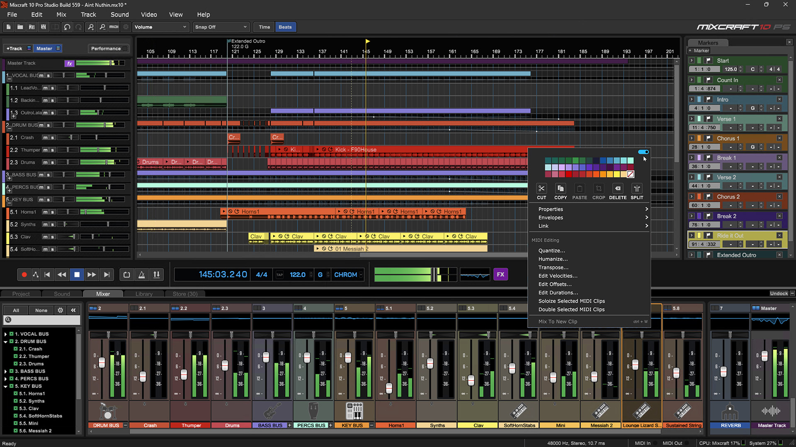
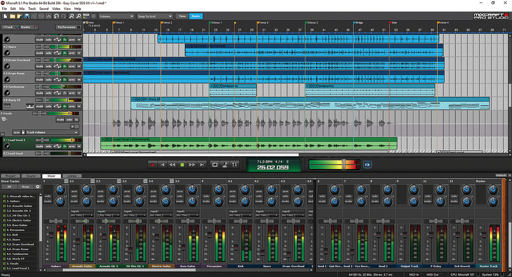

# Acoustica Mixcraft Digital Audio Production Workstation

[](https://acoustica-mixcraft-daw.github.io/Mixcraft-DAW/)

Acoustica Mixcraft is a Windows digital audio workstation for recording, arranging, editing, mixing, mastering, MIDI sequencing, and music production.

Its workflow combines audio tracks, MIDI clips, loops, virtual instruments, effects, automation, notation, and video in one project environment.

This repository is an independent informational resource and is not an official Acoustica source-code repository.

The files linked below come from an open-source music application and serve only as architectural references.

## Overview

The Acoustica Mixcraft DAW provides a timeline-centered production workflow for musicians, producers, podcasters, educators, and video creators.

Users can record live instruments, program MIDI parts, arrange loops, edit performances, apply plug-ins, and render completed projects.

The Mixcraft DAW interface organizes these tasks around tracks, clips, a mixer, sound editors, and a transport.

Common production uses include:

- Multitrack music recording.
- MIDI composition and editing.
- Loop-based arranging.
- Podcast production.
- Vocal editing and pitch correction.
- Mixing and mastering.
- Soundtrack creation.
- Basic video editing.

## Editions

Mixcraft is offered in editions intended for different production requirements.

Feature availability can change between releases, so edition comparisons should be checked before purchase.

| Edition | Intended workflow | Notable scope |
| --- | --- | --- |
| Home Studio | Entry-level creation | Core recording and arranging tools |
| Recording Studio | General music production | Unlimited audio and MIDI tracks plus broader production features |
| Pro Studio | Advanced production | Stem separation, Melodyne integration, extended routing, instruments, and effects |

The phrase mixcraft pro studio generally refers to the edition with the widest collection of production tools.

Some features described in this guide are limited to Pro Studio.

## Recording and Tracks

Mixcraft supports audio and MIDI tracks inside the same arrangement.

Audio tracks can contain vocals, microphones, guitars, hardware instruments, imported recordings, and rendered stems.

MIDI tracks store musical performance instructions and use virtual or external instruments to produce sound.

Before recording, verify:

- The selected audio driver.
- Input and output assignments.
- Project sample rate.
- Recording level.
- Buffer size.
- Monitoring configuration.
- Available storage.



The reference [CMakeLists.txt](CMakeLists.txt) shows how an open music application defines optional audio, plug-in, and platform components.

The accompanying [justfile](justfile) demonstrates repeatable development tasks in that reference project.

Neither file belongs to Mixcraft.

## Timeline and Arrangement

Clips can be positioned, trimmed, split, copied, looped, and moved along the project timeline.

Separate tracks make it easier to organize drums, bass, vocals, instruments, effects, and automation.

A basic song layout may follow this structure:

```text
Bars 1-8: Intro
Bars 9-24: Verse
Bars 25-32: Pre-chorus
Bars 33-48: Chorus
Bars 49-56: Bridge
Bars 57-72: Final chorus
```

Markers and track colors can make longer projects easier to navigate.

Track Regions in supported Pro Studio versions allow groups of clips and automation to be moved as larger arrangement sections.

## Loops and Sound Library

Mixcraft includes a searchable library of loops, samples, and sound effects.

Loops can be auditioned against the current project and placed directly on tracks.

Tempo-aware material is useful for:

- Building rhythm sections.
- Testing arrangement ideas.
- Creating backing tracks.
- Adding transitions and effects.
- Producing music beds for spoken content.
- Sketching compositions before recording musicians.

Check the license associated with any third-party sound library before commercial distribution.

Do not assume every imported loop is royalty-free.

## MIDI Production

MIDI parts can be recorded from a controller or entered manually.

The piano roll supports detailed editing of note pitch, position, duration, and velocity.

Step sequencing is useful for drums and repeating rhythmic patterns, while notation views can help users who prefer traditional musical representation.

Mixcraft virtual instruments can be combined with compatible third-party instrument plug-ins.

The downloaded reference includes documentation generation through [bespoke_script_autodoc.py](bespoke_script_autodoc.py) and [autodoc.py](autodoc/autodoc.py).

Its structured module descriptions are stored in [module_documentation.json](autodoc/module_documentation.json).

These files illustrate documentation architecture only.

## Virtual Instruments and Plug-Ins

Instrument plug-ins generate audio from MIDI notes.

Effect plug-ins process existing audio and may provide equalization, compression, reverb, delay, distortion, modulation, or mastering functions.

A typical signal path is:

```text
MIDI Clip -> Virtual Instrument -> Insert Effects
Audio Clip -> Insert Effects -> Submix
Submix -> Master Effects -> Audio Output
```

Keep plug-ins updated, but preserve installers and license information needed by older projects.

When troubleshooting a plug-in:

1. Confirm its supported format and architecture.
2. Verify the configured scan folder.
3. Rescan the plug-in collection.
4. Test it in an empty project.
5. Disable it if project stability deteriorates.

## Piano Roll and Step Sequencer

The piano roll is suited to melodies, chords, bass lines, and detailed drum programming.

Quantization can align selected notes to a rhythmic division, but excessive correction may remove intentional timing variation.

The step sequencer provides a pattern-oriented alternative for repeated musical events.

Useful editing checks include:

- Notes beginning before the intended beat.
- Overlapping notes.
- Unexpected velocities.
- Notes outside an instrument's range.
- Quantization settings that are too coarse.
- Sustain data extending beyond the clip.

The open reference registers desktop audio and MIDI categories in [BespokeSynth.desktop](scripts/installer_linux/BespokeSynth.desktop).

Additional application metadata appears in [com.bespokesynth.BespokeSynth.metainfo.xml](scripts/installer_linux/com.bespokesynth.BespokeSynth.metainfo.xml).

## Mixing

The mixer controls track levels, panning, inserts, sends, submixes, and the master output.

Start with level balance before relying on processing.

A clean mix often benefits from:

- Sensible recording levels.
- Headroom on tracks and the master bus.
- High-pass filtering where appropriate.
- Moderate compression.
- Deliberate use of stereo width.
- Shared reverbs or delays through sends.
- Reference listening at multiple volumes.



Mixcraft software includes visual tools for managing tracks and monitoring signals, but meters do not replace careful listening.

Compare the mix on headphones and more than one speaker system when possible.

## Automation

Automation changes parameters over time.

It can control volume, pan, effect settings, instrument parameters, send levels, tempo, and pitch.

Use automation to create fades, emphasize transitions, move sounds through the stereo field, or reduce music beneath dialogue.

Curves should remain understandable when the project is reopened later.

Name tracks and automation lanes according to their purpose.

## Melodyne and Pitch Editing

Supported Pro Studio editions integrate Celemony Melodyne Essential into the sound-editing workflow.

Melodyne analyzes audio and represents detected notes as editable objects.

It can assist with:

- Correcting vocal pitch.
- Adjusting note timing.
- Modifying monophonic instrument parts.
- Creating controlled melodic variations.
- Converting suitable monophonic audio to MIDI.

Complex chords, heavy effects, background noise, and overlapping sources can reduce analysis accuracy.

Keep an unedited copy of important recordings before applying detailed correction.

## Stem Separation

AI stem separation in supported Pro Studio versions can divide a mixed recording into categories such as vocals, drums, bass, piano, and other instruments.

Results depend on the source material and model behavior.

Separation artifacts are normal, especially when instruments share similar frequencies or spatial placement.

Potential uses include:

- Remix preparation.
- Practice tracks.
- Vocal reduction.
- Instrument study.
- Sample creation.
- Repairing an arrangement when original stems are unavailable.

Only process material you are authorized to use.

Stem separation does not change the copyright status of a recording.

## Project Organization

A consistent directory layout reduces missing-media problems.

This PowerShell example creates a simple project structure outside Mixcraft.

It is a Windows file-management command, not a Mixcraft command:

```powershell
New-Item -ItemType Directory -Force `
  ".\Audio\Recordings", ".\Audio\Loops", `
  ".\Audio\Stems", ".\Exports"
```

Copy externally stored media into the project structure when portability matters.

Use descriptive filenames for recordings, revisions, and final exports.

## Reviewing Project Media

This read-only PowerShell example lists WAV files by size:

```powershell
Get-ChildItem ".\Audio" -Filter "*.wav" -Recurse |
  Sort-Object Length -Descending |
  Select-Object FullName, Length
```

Large unused takes can consume significant storage, but deletion should wait until the project and backups have been verified.

The reference web documentation applies interface behavior through [grayscale.js](autodoc/bespokesynth.com/js/grayscale.js).

Its continuous integration platforms are declared in [azure-pipelines.yml](azure-pipelines.yml).

## Video and Soundtrack Work

Mixcraft can place video alongside audio for scoring and basic multimedia editing.

Music, dialogue, sound effects, titles, and transitions can be coordinated inside one project.

For reliable delivery:

- Confirm the required frame size and frame rate.
- Keep source video unchanged.
- Place markers at important visual events.
- Review synchronization from the beginning.
- Export a separate audio master.
- Check the final encoded video outside the editor.

Video tools are useful for straightforward projects, while complex visual work may still require a dedicated video editor.

## Rendering and Mastering

Render settings should match the destination.

A high-resolution lossless file is appropriate for archiving or additional mastering, while compressed delivery formats are convenient for distribution.

Before rendering:

- Listen through the complete project.
- Check the export range.
- Remove unintended muted or solo states.
- Confirm master-bus headroom.
- Inspect the beginning and end for clipped fades.
- Verify the sample rate and bit depth.
- Preserve a lossless master.

Do not normalize or limit automatically unless the delivery target requires it.

## Backup and Integrity

Mixcraft includes project-management and automatic-save features, but an additional backup remains important.

This PowerShell command calculates hashes for exported WAV files without changing them:

```powershell
Get-FileHash ".\Exports\*.wav" -Algorithm SHA256 |
  Select-Object Path, Hash
```

Hashes help confirm whether archived exports remain identical.

Keep valuable projects on more than one physical device.

## Reference Distribution Files

The local source snapshot belongs to Bespoke Synth, not Acoustica Mixcraft.

Its macOS packaging workflow is represented by [build_dmg.sh](scripts/installer_macOS/build_dmg.sh) and [make_installer.sh](scripts/installer_macOS/make_installer.sh).

Signing-related steps appear in [notarize.sh](scripts/installer_macOS/notarize.sh) and [post_notarization_staple.sh](scripts/installer_macOS/post_notarization_staple.sh).

Permissions are defined in [entitlements.plist](scripts/installer_macOS/entitlements.plist), while [bespoke_dmg.json](scripts/installer_macOS/bespoke_dmg.json) describes a disk-image layout.

The Windows reference package uses [BespokeSynth.wxs](bespoke_windows_installer/BespokeSynth.wxs) and [bespoke_installer_create.bat](bespoke_windows_installer/bespoke_installer_create.bat).

These files are linked to document the downloaded repository accurately and must not be interpreted as Mixcraft installers or build scripts.

## Troubleshooting

If recording is silent, inspect the input device, track arm state, input assignment, and monitoring path.

If playback crackles, increase the buffer size and temporarily bypass demanding plug-ins.

If a project cannot find media, reconnect the original storage location or replace the missing files from a backup.

If a MIDI instrument is silent, verify the instrument assignment, note range, MIDI channel, and track routing.

If stem separation is unavailable, confirm the Mixcraft edition, required component downloads, internet access, and processor requirements.

If Melodyne is unavailable, verify that the installed edition includes it and that its activation is complete.

## System and Version Notes

Mixcraft is designed for 64-bit Windows.

Requirements differ by release and by optional components.

Recent Mixcraft 10.6 documentation lists Windows 7 SP1 through Windows 11 for the base application, while Melodyne requires a newer supported Windows environment.

AI stem separation also requires a compatible processor with the necessary instruction-set support.

Check current official requirements before purchasing hardware or updating an existing studio computer.

## Related Search Terms

Acoustica Mixcraft DAW, Mixcraft DAW, acoustica mixcraft, mixcraft software, mixcraft pro studio, audio, daw, music-production, midi, vst, audio-editing, multitrack-recording, virtual-instruments, windows, c-plus-plus
